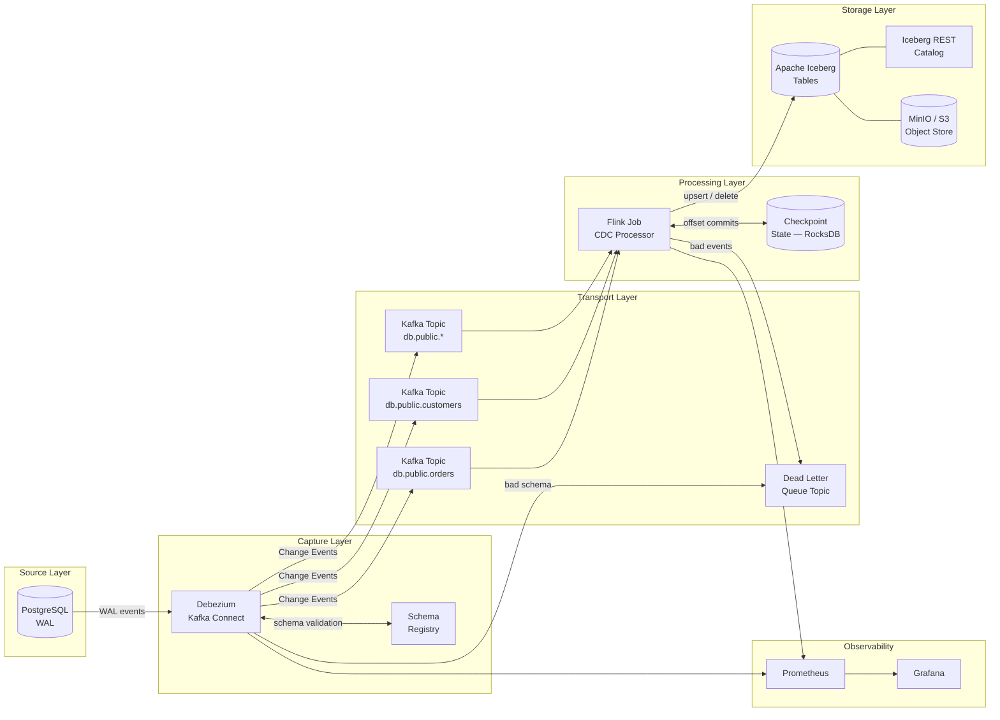
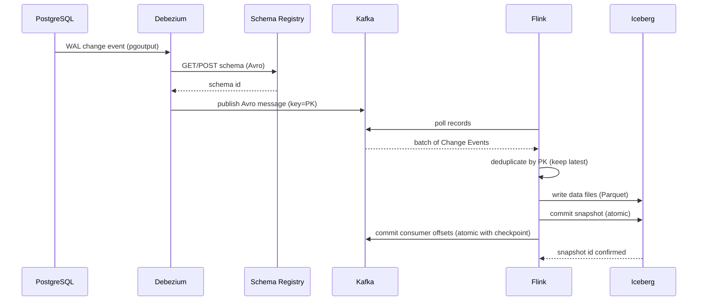

# Design Document: CDC Pipeline

## Overview

The CDC Pipeline is a real-time data replication system that captures row-level changes from a PostgreSQL source database and propagates them to an Apache Iceberg lakehouse. It is Project 5 in a data engineering portfolio series and demonstrates production-grade patterns: log-based replication, exactly-once delivery, schema evolution, upsert-at-scale, and end-to-end observability.

### Technology Stack

| Layer | Technology | Role |
|---|---|---|
| Source | PostgreSQL 15 | Transactional source with WAL logical replication |
| Capture | Debezium 2.x (Kafka Connect) | WAL reader; publishes Change Events to Kafka |
| Transport | Apache Kafka 3.x + Confluent Schema Registry | Durable, ordered event bus with Avro schema enforcement |
| Processing | Apache Flink 1.18 | Stateful stream processor; applies upsert logic to Iceberg |
| Storage | Apache Iceberg (REST catalog + MinIO/S3) | ACID lakehouse target with time-travel and schema evolution |
| Observability | Prometheus + Grafana | Metrics collection and dashboarding |
| Deployment | Docker Compose | Single-command local environment |

### Design Goals

1. **Exactly-once end-to-end** — no duplicates or missing rows under failure and restart.
2. **Near-real-time** — source change visible in Iceberg within 10 seconds under normal load.
3. **Schema-safe** — additive schema changes propagate automatically; breaking changes are quarantined.
4. **Observable** — every pipeline stage emits metrics; lag and latency alerts fire before consumers are impacted.
5. **Portfolio-reproducible** — single `docker compose up` brings the full stack to life.

---

## Architecture

### High-Level System Diagram



### Data Flow — Happy Path

```
PostgreSQL DML
  → WAL segment written
  → Debezium reads WAL via pgoutput plugin
  → Debezium serialises Change Event as Avro, validates against Schema Registry
  → Debezium publishes to Kafka topic (key = primary key bytes)
  → Flink KafkaSource reads event, deserialises Avro
  → Flink deduplicates within micro-batch (keep latest per PK)
  → Flink writes upsert/delete to Iceberg via IcebergSink
  → Flink checkpoint commits Kafka offsets + Iceberg snapshot atomically
  → Iceberg snapshot becomes visible to readers
```

### Data Flow — Failure Recovery

```
Flink job crashes mid-batch
  → Flink restarts from last successful checkpoint
  → Kafka offsets rewound to checkpoint-committed position
  → Iceberg partial write (if any) rolled back — snapshot never committed
  → Flink replays events from rewound offset
  → Exactly-once guaranteed: no duplicate Iceberg rows
```

### Component Interaction Sequence



---

## Components and Interfaces

### 2.1 PostgreSQL Source

**Configuration requirements:**
- `wal_level = logical`
- `max_replication_slots ≥ 2` (one for Debezium, one spare)
- `max_wal_senders ≥ 2`
- Dedicated replication user: `cdc_user` with `REPLICATION`, `LOGIN`, and `SELECT` on monitored tables
- Replication slot: `debezium_slot` (plugin: `pgoutput`)
- Publication: `cdc_publication` covering all monitored tables

**WAL retention guard:**
A PostgreSQL `pg_stat_replication_slots` monitor checks slot lag. If `pg_wal_lsn_diff(pg_current_wal_lsn(), restart_lsn) > 10 GB`, a WARNING is written to the PostgreSQL log.

### 2.2 Debezium Connector

Debezium runs as a Kafka Connect connector (`io.debezium.connector.postgresql.PostgresConnector`).

**Key connector properties:**

```json
{
  "connector.class": "io.debezium.connector.postgresql.PostgresConnector",
  "database.hostname": "postgres",
  "database.port": "5432",
  "database.user": "cdc_user",
  "database.password": "${CDC_DB_PASSWORD}",
  "database.dbname": "sourcedb",
  "database.server.name": "db",
  "plugin.name": "pgoutput",
  "publication.name": "cdc_publication",
  "slot.name": "debezium_slot",
  "snapshot.mode": "initial",
  "snapshot.locking.mode": "minimal",
  "key.converter": "io.confluent.kafka.serializers.KafkaAvroSerializer",
  "value.converter": "io.confluent.kafka.serializers.KafkaAvroSerializer",
  "key.converter.schema.registry.url": "http://schema-registry:8081",
  "value.converter.schema.registry.url": "http://schema-registry:8081",
  "errors.tolerance": "all",
  "errors.deadletterqueue.topic.name": "cdc.dead-letter-queue",
  "errors.deadletterqueue.context.headers.enable": "true",
  "tombstones.on.delete": "true",
  "heartbeat.interval.ms": "60000",
  "heartbeat.action.query": "INSERT INTO cdc_heartbeat(ts) VALUES(NOW()) ON CONFLICT(id) DO UPDATE SET ts=NOW()"
}
```

**Snapshot behaviour:**
- `snapshot.mode = initial` — full table scan on first start, WAL streaming thereafter.
- `snapshot.locking.mode = minimal` — holds `ACCESS SHARE` lock only long enough to read the consistent LSN, then releases.
- Snapshot offset stored in Kafka Connect's offset storage topic; restart resumes from WAL.

**Retry / backoff:**
Debezium's Kafka Connect framework retries failed tasks with exponential backoff. The connector sets `errors.retry.delay.max.ms = 60000` (60 s ceiling).

### 2.3 Schema Registry

Confluent Schema Registry stores Avro schemas for every Kafka topic.

**Compatibility mode:** `BACKWARD` (default) — new schema must be readable by consumers using the previous schema. This allows:
- Adding optional fields with defaults ✓
- Removing fields ✓ (old consumers ignore unknown fields)
- Widening numeric types ✓

Breaking changes (e.g., `VARCHAR → INT`) are rejected at publish time; Debezium routes the event to the DLQ.

**Schema naming convention:** `<topic>-key` and `<topic>-value` (Confluent TopicNameStrategy).

### 2.4 Kafka Topics

| Topic | Purpose | Partitions | Replication Factor | Min ISR | Retention |
|---|---|---|---|---|---|
| `db.public.<table>` | Per-table Change Events | 6 | 3 | 2 | 7 days |
| `cdc.dead-letter-queue` | Unprocessable events | 3 | 3 | 2 | 30 days |
| `cdc.heartbeat` | Latency measurement | 1 | 3 | 2 | 1 day |
| `connect-offsets` | Debezium offset storage | 25 | 3 | 2 | Infinite |
| `connect-configs` | Connector configs | 1 | 3 | 2 | Infinite |
| `connect-status` | Connector status | 5 | 3 | 2 | Infinite |

**Partition key:** Debezium uses the row's primary key (serialised as Avro) as the Kafka message key. Kafka's default partitioner (murmur2 hash of key) ensures all events for a given row land in the same partition, preserving per-row order.

### 2.5 Flink CDC Processor Job

The Flink job is a single streaming application with the following operator graph:

```
KafkaSource (multi-topic)
  → AvroDeserializer
  → ChangeEventRouter (per-table branching)
  → [per table] DeduplicationOperator (keyed by PK, within checkpoint window)
  → [per table] SchemaEvolutionOperator
  → [per table] IcebergSink (upsert mode)
```

**Parallelism:** Configurable; default = number of Kafka partitions per topic (6).

**State backend:** RocksDB with incremental checkpoints written to S3/MinIO.

**Checkpointing:**
- Interval: 30 s (configurable)
- Mode: `EXACTLY_ONCE`
- Timeout: 60 s
- Max concurrent checkpoints: 1
- Tolerated failures before job failure: 3

### 2.6 Iceberg Tables

Each monitored source table maps to one Iceberg table in the `cdc` namespace.

**Catalog:** REST catalog (`http://iceberg-rest:8181`) backed by MinIO.

**Table naming:** `cdc.<source_table>` (e.g., `cdc.orders`, `cdc.customers`).

**Write mode:** `upsert` via Flink's `IcebergSink` with equality delete files keyed on the source primary key column(s).

**Partitioning:** `PARTITION BY DAYS(updated_at)` — daily partitions on the event timestamp to enable efficient time-range queries and partition pruning.

### 2.7 Dead Letter Queue

**Topic:** `cdc.dead-letter-queue`

**Event routing triggers:**
1. Schema Registry rejects publish (incompatible schema)
2. Flink cannot deserialise Avro bytes
3. Incompatible column type change detected by SchemaEvolutionOperator

**DLQ message envelope (Avro):**

```json
{
  "original_topic": "db.public.orders",
  "original_partition": 2,
  "original_offset": 100432,
  "error_type": "DESERIALIZATION_FAILURE | SCHEMA_INCOMPATIBLE | TYPE_MISMATCH",
  "error_message": "Cannot cast VARCHAR to INT for column 'status'",
  "error_timestamp_utc": "2024-01-15T10:30:00Z",
  "raw_payload": "<base64-encoded original Kafka message bytes>"
}
```

**Replay utility:** A standalone Python script (`scripts/dlq_replay.py`) reads from `cdc.dead-letter-queue`, optionally filters by `error_type` or time range, and re-publishes raw payloads to the original topic after the root cause is resolved.

### 2.8 Monitoring Stack

| Component | Metrics Endpoint | Scrape Interval |
|---|---|---|
| Flink JobManager | `:9249/metrics` (Prometheus reporter) | 15 s |
| Flink TaskManager | `:9249/metrics` | 15 s |
| Kafka (JMX Exporter) | `:9308/metrics` | 15 s |
| Debezium (JMX Exporter) | `:9404/metrics` | 15 s |
| PostgreSQL (postgres_exporter) | `:9187/metrics` | 15 s |

**Grafana dashboard panels:**
1. Kafka consumer lag per topic-partition (line chart)
2. Flink checkpoint duration (histogram)
3. Flink checkpoint failure count (counter)
4. Iceberg commit latency (gauge)
5. DLQ message count (counter + alert threshold line)
6. End-to-end heartbeat latency (line chart)
7. Debezium WAL lag (bytes behind)
8. Flink records-in / records-out per operator

---

## Data Models

### 3.1 Debezium Change Event Schema (Avro)

Every Change Event published to Kafka follows the Debezium envelope schema:

```json
{
  "type": "record",
  "name": "Envelope",
  "namespace": "db.public.orders",
  "fields": [
    {
      "name": "before",
      "type": ["null", {
        "type": "record",
        "name": "Value",
        "fields": [
          { "name": "id",         "type": "int" },
          { "name": "customer_id","type": "int" },
          { "name": "amount",     "type": { "type": "bytes", "logicalType": "decimal", "precision": 10, "scale": 2 } },
          { "name": "status",     "type": "string" },
          { "name": "created_at", "type": { "type": "long", "logicalType": "timestamp-micros" } },
          { "name": "updated_at", "type": { "type": "long", "logicalType": "timestamp-micros" } }
        ]
      }],
      "default": null
    },
    {
      "name": "after",
      "type": ["null", "Value"],
      "default": null
    },
    {
      "name": "source",
      "type": {
        "type": "record",
        "name": "Source",
        "fields": [
          { "name": "version",   "type": "string" },
          { "name": "connector", "type": "string" },
          { "name": "name",      "type": "string" },
          { "name": "ts_ms",     "type": "long" },
          { "name": "db",        "type": "string" },
          { "name": "schema",    "type": "string" },
          { "name": "table",     "type": "string" },
          { "name": "lsn",       "type": ["null", "long"], "default": null },
          { "name": "txId",      "type": ["null", "long"], "default": null }
        ]
      }
    },
    { "name": "op",          "type": "string" },
    { "name": "ts_ms",       "type": ["null", "long"], "default": null },
    { "name": "transaction",
      "type": ["null", {
        "type": "record", "name": "TransactionBlock",
        "fields": [
          { "name": "id",                "type": "string" },
          { "name": "total_order",       "type": "long" },
          { "name": "data_collection_order", "type": "long" }
        ]
      }],
      "default": null
    }
  ]
}
```

**`op` field values:**
- `c` — INSERT (create)
- `u` — UPDATE
- `d` — DELETE
- `r` — READ (snapshot)
- `t` — TRUNCATE

### 3.2 Iceberg Table Schema — `cdc.orders`

```sql
CREATE TABLE cdc.orders (
  id           INT          NOT NULL,   -- source PK
  customer_id  INT,
  amount       DECIMAL(10,2),
  status       VARCHAR,
  created_at   TIMESTAMP,
  updated_at   TIMESTAMP,
  _cdc_op      VARCHAR,                 -- last operation: c/u/d/r
  _cdc_ts      TIMESTAMP,               -- Debezium event timestamp
  _cdc_lsn     BIGINT,                  -- WAL LSN for ordering
  _cdc_deleted BOOLEAN DEFAULT FALSE    -- soft-delete flag
)
PARTITIONED BY (days(updated_at))
TBLPROPERTIES (
  'write.upsert.enabled' = 'true',
  'write.merge.mode'     = 'merge-on-read',
  'format-version'       = '2'
);
```

**Equality delete key:** `id` (source primary key).

**Iceberg v2 row-level deletes:** DELETE events write an equality delete file keyed on `id`; Flink's `IcebergSink` handles this transparently.

### 3.3 Dead Letter Queue Message Schema (Avro)

```json
{
  "type": "record",
  "name": "DLQEnvelope",
  "namespace": "cdc",
  "fields": [
    { "name": "original_topic",     "type": "string" },
    { "name": "original_partition", "type": "int" },
    { "name": "original_offset",    "type": "long" },
    { "name": "error_type",         "type": { "type": "enum", "name": "ErrorType",
        "symbols": ["DESERIALIZATION_FAILURE", "SCHEMA_INCOMPATIBLE", "TYPE_MISMATCH", "PROCESSING_ERROR"] } },
    { "name": "error_message",      "type": "string" },
    { "name": "error_timestamp_utc","type": { "type": "long", "logicalType": "timestamp-millis" } },
    { "name": "raw_payload",        "type": "bytes" }
  ]
}
```

### 3.4 Heartbeat Table Schema (PostgreSQL)

```sql
CREATE TABLE cdc_heartbeat (
  id         INT PRIMARY KEY DEFAULT 1,
  ts         TIMESTAMPTZ NOT NULL DEFAULT NOW(),
  pipeline   VARCHAR(64) NOT NULL DEFAULT 'main'
);
-- Constraint: only one row (id=1), updated in-place every 60 s
```

### 3.5 Reconciliation Result Schema

```python
@dataclass
class ReconciliationResult:
    table_name: str
    run_timestamp: datetime
    source_row_count: int
    target_row_count: int
    count_match: bool
    sampled_rows: int
    checksum_mismatches: list[ChecksumMismatch]

@dataclass
class ChecksumMismatch:
    primary_key: Any
    column_name: str
    source_value: Any
    target_value: Any
```

---

## Correctness Properties

*A property is a characteristic or behavior that should hold true across all valid executions of a system — essentially, a formal statement about what the system should do. Properties serve as the bridge between human-readable specifications and machine-verifiable correctness guarantees.*

### Property 1: Kafka message key equals source primary key

*For any* row inserted, updated, or deleted in a monitored source table, the Kafka message published by Debezium SHALL have a key that deserialises to the exact primary key value of that row.

**Validates: Requirements 4.4**

---

### Property 2: Incompatible schema change routes event to DLQ

*For any* Change Event whose schema is incompatible with the registered Schema Registry schema (e.g., type narrowing, field type mismatch), the event SHALL be rejected and appear in `cdc.dead-letter-queue` with a non-null `error_type` and `error_message`.

**Validates: Requirements 4.6**

---

### Property 3: Upsert and delete operation routing

*For any* Change Event with operation type `c` or `u`, after Flink processes it, the Iceberg table row identified by the event's primary key SHALL equal the event's `after` image. *For any* Change Event with operation type `d`, after Flink processes it, the row identified by the primary key SHALL not appear in Iceberg query results (or SHALL be marked `_cdc_deleted = TRUE`).

**Validates: Requirements 5.1, 5.2**

---

### Property 4: Within-batch deduplication preserves latest event

*For any* micro-batch containing multiple Change Events for the same primary key, after Flink processes the batch, the Iceberg table SHALL reflect only the state described by the event with the highest WAL LSN (latest event) for that key — intermediate states SHALL NOT be visible.

**Validates: Requirements 5.3, 5.4**

---

### Property 5: Exactly-once on failure and restart

*For any* sequence of Change Events, if the Flink job fails at any point and restarts from the last successful checkpoint, the final Iceberg table state SHALL be identical to the state produced by a failure-free run of the same event sequence — no rows SHALL be duplicated and no rows SHALL be missing.

**Validates: Requirements 6.2, 6.3, 6.4**

---

### Property 6: Additive schema evolution propagates to Iceberg

*For any* new column (name, type) added to a monitored source table, after Flink processes the first Change Event containing that column, the target Iceberg table SHALL contain a column with the same name and a compatible type, and the written row SHALL carry the correct value for that column.

**Validates: Requirements 7.1**

---

### Property 7: Dropped column retained with NULL in Iceberg

*For any* column dropped from a monitored source table, the corresponding Iceberg column SHALL remain present in the table schema, and all rows written after the drop SHALL have `NULL` for that column.

**Validates: Requirements 7.2**

---

### Property 8: Type widening updates Iceberg column type

*For any* backward-compatible type widening on a source column (e.g., `INT → BIGINT`, `FLOAT → DOUBLE`), the Iceberg column type SHALL be updated to the wider type before the first event using the new type is written, and no data loss SHALL occur.

**Validates: Requirements 7.3**

---

### Property 9: Incompatible type change routes to DLQ with alert

*For any* incompatible column type change (e.g., `VARCHAR → INT`), all Change Events affected by that change SHALL be routed to `cdc.dead-letter-queue` with `error_type = TYPE_MISMATCH`, and an alert SHALL be emitted describing the incompatible change.

**Validates: Requirements 7.4**

---

### Property 10: DLQ messages contain complete metadata

*For any* event routed to `cdc.dead-letter-queue` for any reason, the DLQ message SHALL contain all of: `original_topic`, `original_partition`, `original_offset`, `error_type`, `error_message`, `error_timestamp_utc`, and `raw_payload` — none of these fields SHALL be null or empty.

**Validates: Requirements 8.2**

---

### Property 11: DLQ replay delivers events to original topic

*For any* set of events in `cdc.dead-letter-queue`, after the replay utility runs, each event SHALL appear in its original Kafka topic with the original payload bytes intact.

**Validates: Requirements 8.5**

---

### Property 12: Heartbeat latency measurement accuracy

*For any* heartbeat event written to the source `cdc_heartbeat` table, the pipeline latency measurement recorded by Flink SHALL equal `iceberg_commit_timestamp − heartbeat_write_timestamp` within a tolerance of ±1 second.

**Validates: Requirements 9.4**

---

### Property 13: Reconciliation correctly identifies row count discrepancies

*For any* source table state and corresponding Iceberg table state, the reconciliation job SHALL return the correct source and target row counts, and SHALL flag a discrepancy if and only if the counts differ — with no false positives and no missed discrepancies.

**Validates: Requirements 10.1, 10.2**

---

### Property 14: Checksum comparison identifies all column-level mismatches

*For any* sample of rows where source and target values differ for one or more columns, the checksum comparison SHALL identify every mismatch and log the correct primary key, column name, source value, and target value for each — with no false positives and no missed mismatches.

**Validates: Requirements 10.3, 10.4**

---

### Property 15: End-to-end change propagation within 10 seconds

*For any* INSERT, UPDATE, or DELETE on a monitored source table when all pipeline services are healthy, the change SHALL be visible in the corresponding Iceberg table within 10 seconds of the DML statement completing.

**Validates: Requirements 11.4**

---

## Error Handling

### 5.1 Debezium Error Handling

| Failure Scenario | Behaviour |
|---|---|
| PostgreSQL connection lost | Exponential backoff retry, max 60 s interval |
| WAL slot lag > 10 GB | PostgreSQL emits WARNING log; operator alert via monitoring |
| Schema Registry unreachable | Kafka Connect task fails; retried by Connect framework |
| Incompatible schema on publish | Schema Registry rejects; Debezium routes to DLQ |
| Snapshot interrupted | On restart, Debezium re-runs full snapshot from scratch |

### 5.2 Flink Error Handling

| Failure Scenario | Behaviour |
|---|---|
| Avro deserialisation failure | Event routed to DLQ with `DESERIALIZATION_FAILURE`; processing continues |
| Incompatible type change | Event routed to DLQ with `TYPE_MISMATCH`; alert emitted |
| Iceberg write failure | Flink retries within checkpoint window; if checkpoint fails 3× → job fails |
| Checkpoint failure (1–2×) | Logged as warning; job continues |
| Checkpoint failure (3× consecutive) | Job transitions to FAILED; alert emitted; restart from last good checkpoint |
| Kafka broker unavailable | Flink KafkaSource retries with backoff; checkpoint paused |

### 5.3 DLQ Error Handling

| Failure Scenario | Behaviour |
|---|---|
| DLQ topic unavailable | Error logged; original processing failure propagates |
| DLQ count > 100 in 5 min | Alert emitted to notification channel |
| Replay utility encounters error | Logs failed event; continues with remaining events; exit code non-zero |

### 5.4 Error Classification

```
DESERIALIZATION_FAILURE  — Avro bytes cannot be decoded (corrupt, wrong schema id)
SCHEMA_INCOMPATIBLE      — Schema Registry rejected publish (breaking schema change)
TYPE_MISMATCH            — Column type change is not backward-compatible
PROCESSING_ERROR         — Any other Flink processing exception
```

---

## Testing Strategy

### 6.1 Overview

The testing strategy uses a dual approach:
- **Unit tests** for pure functions: schema evolution logic, deduplication algorithm, DLQ metadata assembly, reconciliation comparison logic, topic naming, type compatibility checks.
- **Property-based tests** for universal correctness properties (see Section 4).
- **Integration tests** for end-to-end pipeline behaviour against real or containerised services.
- **Smoke tests** for infrastructure configuration validation.

### 6.2 Property-Based Testing

**Library:** [Hypothesis](https://hypothesis.readthedocs.io/) (Python) for reconciliation/DLQ/replay utilities; [jqwik](https://jqwik.net/) (Java/Kotlin) for Flink operator unit tests.

**Configuration:** Minimum 100 iterations per property test.

**Tag format:** `# Feature: cdc-pipeline, Property {N}: {property_text}`

Each correctness property (Section 4) maps to exactly one property-based test:

| Property | Test Module | Generator Strategy |
|---|---|---|
| P1: Kafka key = PK | `test_debezium_key.py` | Generate random rows with various PK types (int, uuid, composite) |
| P2: Incompatible schema → DLQ | `test_schema_registry.py` | Generate incompatible schema change pairs |
| P3: Upsert/delete routing | `test_flink_operator.py` | Generate random Change Events (c/u/d) with random field values |
| P4: Within-batch dedup | `test_dedup_operator.py` | Generate batches with 1–N events per PK, random LSN ordering |
| P5: Exactly-once on restart | `test_exactly_once.py` | Generate event sequences, inject crash at random position |
| P6: Additive schema evolution | `test_schema_evolution.py` | Generate new column (name, type) pairs |
| P7: Dropped column → NULL | `test_schema_evolution.py` | Generate column drop scenarios |
| P8: Type widening | `test_schema_evolution.py` | Generate valid widening pairs from a defined set |
| P9: Incompatible type → DLQ | `test_schema_evolution.py` | Generate invalid type change pairs |
| P10: DLQ metadata completeness | `test_dlq.py` | Generate events of each error type |
| P11: DLQ replay | `test_dlq_replay.py` | Generate sets of DLQ events with various error types |
| P12: Heartbeat latency accuracy | `test_heartbeat.py` | Generate heartbeat events with known timestamps |
| P13: Reconciliation count accuracy | `test_reconciliation.py` | Generate source/target table states with known discrepancies |
| P14: Checksum mismatch detection | `test_reconciliation.py` | Generate row samples with known column-level differences |
| P15: End-to-end < 10 s | `test_e2e.py` | Integration test; generate DML operations of each type |

### 6.3 Unit Tests

Focus areas:
- `topic_name(database, schema, table) → str` — naming convention
- `is_type_widening(from_type, to_type) → bool` — type compatibility matrix
- `deduplicate_batch(events: List[ChangeEvent]) → List[ChangeEvent]` — keep latest per PK
- `build_dlq_envelope(event, error) → DLQEnvelope` — metadata assembly
- `compare_row_checksums(source_row, target_row) → List[ChecksumMismatch]` — checksum logic
- `apply_schema_change(iceberg_schema, change) → IcebergSchema` — schema evolution

### 6.4 Integration Tests

Run against Docker Compose environment:
1. Full snapshot: start Debezium against populated table, verify all rows in Kafka
2. WAL streaming: INSERT/UPDATE/DELETE, verify events in Kafka with correct `op` and payload
3. Flink upsert: end-to-end INSERT → Iceberg row visible
4. Flink delete: end-to-end DELETE → row absent from Iceberg
5. Schema evolution: ALTER TABLE ADD COLUMN → Iceberg schema updated, new rows correct
6. Checkpoint recovery: kill Flink mid-batch, restart, verify no duplicates in Iceberg
7. DLQ routing: inject malformed Avro bytes, verify DLQ message with correct metadata
8. Replay utility: populate DLQ, run replay, verify events in original topic

### 6.5 Smoke Tests

Run as part of `docker compose up` health checks:
- PostgreSQL: `wal_level = logical`, replication slot exists, `cdc_user` has correct privileges
- Kafka: all required topics exist with correct replication factor, min ISR, and retention
- Schema Registry: running, compatibility mode = `BACKWARD`
- Flink: job running, checkpointing enabled
- Grafana: dashboard exists with all required panels

### 6.6 Key Algorithms (Low-Level Design)

#### Deduplication Algorithm

```python
def deduplicate_batch(events: list[ChangeEvent]) -> list[ChangeEvent]:
    """
    Within a Flink micro-batch, keep only the latest event per primary key.
    'Latest' is defined by the WAL LSN stored in event.source.lsn.
    
    Time complexity: O(n)
    Space complexity: O(k) where k = distinct PKs in batch
    """
    latest: dict[PrimaryKey, ChangeEvent] = {}
    for event in events:
        pk = event.primary_key()
        existing = latest.get(pk)
        if existing is None or event.source.lsn > existing.source.lsn:
            latest[pk] = event
    return list(latest.values())
```

#### Schema Evolution Algorithm

```python
def apply_schema_change(
    current_iceberg_schema: Schema,
    incoming_avro_schema: AvroSchema,
    table_identifier: TableIdentifier,
    catalog: Catalog,
) -> Schema:
    """
    Reconcile the incoming Avro schema against the current Iceberg schema.
    Returns the updated Iceberg schema after applying safe changes.
    Raises IncompatibleTypeChangeError for breaking changes.
    """
    current_fields = {f.name: f for f in current_iceberg_schema.fields}
    incoming_fields = {f["name"]: f for f in incoming_avro_schema["fields"]}
    
    updates = SchemaUpdate(catalog.load_table(table_identifier))
    
    for name, avro_field in incoming_fields.items():
        if name not in current_fields:
            # New column — add with NULL default
            updates.add_column(name, avro_to_iceberg_type(avro_field["type"]))
        else:
            current_type = current_fields[name].field_type
            incoming_type = avro_to_iceberg_type(avro_field["type"])
            if current_type != incoming_type:
                if is_type_widening(current_type, incoming_type):
                    updates.update_column(name, incoming_type)
                else:
                    raise IncompatibleTypeChangeError(name, current_type, incoming_type)
    # Dropped columns: no action — Iceberg retains them, new rows get NULL
    
    return updates.apply()


def is_type_widening(from_type: IcebergType, to_type: IcebergType) -> bool:
    """
    Returns True if the type change is a safe widening.
    Widening pairs: INT→LONG, FLOAT→DOUBLE, DECIMAL(p,s)→DECIMAL(p',s) where p'>p
    """
    WIDENING_MAP = {
        (IntegerType(), LongType()),
        (FloatType(), DoubleType()),
    }
    return (from_type, to_type) in WIDENING_MAP or (
        isinstance(from_type, DecimalType)
        and isinstance(to_type, DecimalType)
        and to_type.precision > from_type.precision
        and to_type.scale == from_type.scale
    )
```

#### Reconciliation Algorithm

```python
def reconcile_table(
    source_conn: Connection,
    iceberg_catalog: Catalog,
    table_name: str,
    sample_size: int = 1000,
) -> ReconciliationResult:
    """
    Compare row counts and column checksums between source PostgreSQL table
    and target Iceberg table.
    """
    source_count = query_scalar(source_conn, f"SELECT COUNT(*) FROM {table_name}")
    target_df = iceberg_catalog.load_table(f"cdc.{table_name}").scan().to_pandas()
    target_count = len(target_df[target_df["_cdc_deleted"] == False])
    
    mismatches = []
    if source_count == target_count:
        # Sample rows for checksum comparison
        sample_pks = random.sample(range(source_count), min(sample_size, source_count))
        source_rows = fetch_rows_by_pk(source_conn, table_name, sample_pks)
        for pk, source_row in source_rows.items():
            target_row = target_df[target_df["id"] == pk].iloc[0].to_dict()
            mismatches.extend(compare_row_checksums(pk, source_row, target_row))
    
    return ReconciliationResult(
        table_name=table_name,
        run_timestamp=datetime.utcnow(),
        source_row_count=source_count,
        target_row_count=target_count,
        count_match=(source_count == target_count),
        sampled_rows=len(source_rows) if source_count == target_count else 0,
        checksum_mismatches=mismatches,
    )


def compare_row_checksums(
    pk: Any,
    source_row: dict[str, Any],
    target_row: dict[str, Any],
) -> list[ChecksumMismatch]:
    """
    Compare column values between source and target rows.
    Ignores CDC metadata columns (_cdc_op, _cdc_ts, _cdc_lsn, _cdc_deleted).
    """
    CDC_COLUMNS = {"_cdc_op", "_cdc_ts", "_cdc_lsn", "_cdc_deleted"}
    mismatches = []
    for col, source_val in source_row.items():
        if col in CDC_COLUMNS:
            continue
        target_val = target_row.get(col)
        if source_val != target_val:
            mismatches.append(ChecksumMismatch(pk, col, source_val, target_val))
    return mismatches
```

#### Checkpoint + Atomic Commit Protocol

```
Flink Checkpoint Barrier received by IcebergSink operator:
  1. Flush all pending Parquet data files to object store (MinIO/S3)
  2. Collect data file metadata (path, size, record count, partition spec)
  3. Store file metadata in Flink operator state (RocksDB)
  4. Acknowledge checkpoint barrier upstream

On Checkpoint Completion (all operators acknowledged):
  5. IcebergSink.notifyCheckpointComplete(checkpointId):
     a. Begin Iceberg transaction
     b. Append all data files from checkpoint state
     c. Commit Iceberg snapshot (atomic — either fully visible or not)
     d. Commit Kafka consumer group offsets (via KafkaOffsetsCommitter)
     e. Clear committed file metadata from operator state

On Job Restart from Checkpoint:
  6. Restore operator state from checkpoint (includes uncommitted file metadata)
  7. Iceberg: any uncommitted files from previous run are orphaned — not in any snapshot
  8. Kafka: offsets rewound to last committed position
  9. Replay events from rewound offset → idempotent re-write of same data files
  10. Next checkpoint commit produces identical Iceberg snapshot
```

### 6.7 Core Function Signatures

```python
# --- Flink Operators (PyFlink / Java equivalents) ---

class AvroDeserializer(DeserializationSchema[ChangeEvent]):
    def deserialize(self, message: bytes) -> ChangeEvent: ...
    def on_error(self, message: bytes, error: Exception) -> None:
        """Routes to DLQ with DESERIALIZATION_FAILURE"""

class DeduplicationOperator(KeyedProcessFunction[PrimaryKey, ChangeEvent, ChangeEvent]):
    def process_element(self, event: ChangeEvent, ctx: Context) -> None:
        """Emits event only if LSN > last seen LSN for this PK"""
    def on_timer(self, timestamp: int, ctx: OnTimerContext) -> None:
        """Clears state for PKs not seen within TTL window"""

class SchemaEvolutionOperator(RichMapFunction[ChangeEvent, ChangeEvent]):
    def map(self, event: ChangeEvent) -> ChangeEvent:
        """Applies schema changes to Iceberg table; raises on incompatible changes"""
    def open(self, config: Configuration) -> None:
        """Initialises Iceberg catalog connection"""

class DLQRouter(ProcessFunction[ChangeEvent, ChangeEvent]):
    def process_element(self, event: ChangeEvent, ctx: Context) -> None:
        """Routes to DLQ side output on error; emits to main output on success"""

# --- Reconciliation Utilities ---

def run_reconciliation(
    tables: list[str],
    source_dsn: str,
    iceberg_catalog_uri: str,
    sample_size: int = 1000,
    alert_fn: Callable[[ReconciliationResult], None] = default_alert,
) -> list[ReconciliationResult]: ...

def replay_dlq(
    dlq_topic: str,
    kafka_bootstrap: str,
    filter_error_type: ErrorType | None = None,
    since: datetime | None = None,
    dry_run: bool = False,
) -> ReplayResult: ...

# --- Topic Management ---

def topic_name(database: str, schema: str, table: str) -> str:
    """Returns '{database}.{schema}.{table}'"""

def create_cdc_topic(
    admin_client: AdminClient,
    topic: str,
    num_partitions: int = 6,
    replication_factor: int = 3,
    retention_ms: int = 7 * 24 * 3600 * 1000,
) -> None: ...

# --- WAL Lag Monitor ---

def check_wal_lag(
    conn: Connection,
    slot_name: str,
    warn_threshold_bytes: int = 10 * 1024 ** 3,  # 10 GB
) -> WalLagStatus:
    """Queries pg_replication_slots; emits WARNING log if lag exceeds threshold"""
```

---

## Infrastructure and Deployment

### 7.1 Docker Compose Service Layout

```yaml
# docker-compose.yml (abbreviated — full file in repo)
services:

  postgres:
    image: postgres:15
    environment:
      POSTGRES_DB: sourcedb
      POSTGRES_USER: postgres
      POSTGRES_PASSWORD: ${POSTGRES_PASSWORD}
    command: >
      postgres
        -c wal_level=logical
        -c max_replication_slots=4
        -c max_wal_senders=4
    ports: ["5432:5432"]
    healthcheck:
      test: ["CMD", "pg_isready", "-U", "postgres"]

  zookeeper:
    image: confluentinc/cp-zookeeper:7.5.0
    environment:
      ZOOKEEPER_CLIENT_PORT: 2181

  kafka:
    image: confluentinc/cp-kafka:7.5.0
    depends_on: [zookeeper]
    environment:
      KAFKA_BROKER_ID: 1
      KAFKA_ZOOKEEPER_CONNECT: zookeeper:2181
      KAFKA_OFFSETS_TOPIC_REPLICATION_FACTOR: 1   # 1 for local dev
      KAFKA_DEFAULT_REPLICATION_FACTOR: 1
      KAFKA_MIN_INSYNC_REPLICAS: 1
    ports: ["9092:9092"]

  schema-registry:
    image: confluentinc/cp-schema-registry:7.5.0
    depends_on: [kafka]
    environment:
      SCHEMA_REGISTRY_KAFKASTORE_BOOTSTRAP_SERVERS: kafka:9092
      SCHEMA_REGISTRY_HOST_NAME: schema-registry
    ports: ["8081:8081"]

  kafka-connect:
    image: debezium/connect:2.4
    depends_on: [kafka, schema-registry, postgres]
    environment:
      BOOTSTRAP_SERVERS: kafka:9092
      GROUP_ID: cdc-connect
      CONFIG_STORAGE_TOPIC: connect-configs
      OFFSET_STORAGE_TOPIC: connect-offsets
      STATUS_STORAGE_TOPIC: connect-status
      KEY_CONVERTER: io.confluent.kafka.serializers.KafkaAvroSerializer
      VALUE_CONVERTER: io.confluent.kafka.serializers.KafkaAvroSerializer
      CONNECT_KEY_CONVERTER_SCHEMA_REGISTRY_URL: http://schema-registry:8081
      CONNECT_VALUE_CONVERTER_SCHEMA_REGISTRY_URL: http://schema-registry:8081
    ports: ["8083:8083"]

  jobmanager:
    image: flink:1.18-scala_2.12
    command: jobmanager
    environment:
      FLINK_PROPERTIES: |
        jobmanager.rpc.address: jobmanager
        state.backend: rocksdb
        state.checkpoints.dir: s3://checkpoints/flink
        execution.checkpointing.interval: 30000
        execution.checkpointing.mode: EXACTLY_ONCE
        metrics.reporter.prom.class: org.apache.flink.metrics.prometheus.PrometheusReporter
        metrics.reporter.prom.port: 9249
    ports: ["8081:8081", "9249:9249"]

  taskmanager:
    image: flink:1.18-scala_2.12
    command: taskmanager
    depends_on: [jobmanager]
    environment:
      FLINK_PROPERTIES: |
        jobmanager.rpc.address: jobmanager
        taskmanager.numberOfTaskSlots: 4
        state.backend: rocksdb
        state.checkpoints.dir: s3://checkpoints/flink

  minio:
    image: minio/minio:latest
    command: server /data --console-address ":9001"
    environment:
      MINIO_ROOT_USER: minioadmin
      MINIO_ROOT_PASSWORD: ${MINIO_PASSWORD}
    ports: ["9000:9000", "9001:9001"]

  iceberg-rest:
    image: tabulario/iceberg-rest:latest
    depends_on: [minio]
    environment:
      CATALOG_WAREHOUSE: s3://warehouse/
      CATALOG_IO__IMPL: org.apache.iceberg.aws.s3.S3FileIO
      AWS_ACCESS_KEY_ID: minioadmin
      AWS_SECRET_ACCESS_KEY: ${MINIO_PASSWORD}
      AWS_REGION: us-east-1
      AWS_S3_ENDPOINT: http://minio:9000
    ports: ["8181:8181"]

  prometheus:
    image: prom/prometheus:latest
    volumes: ["./monitoring/prometheus.yml:/etc/prometheus/prometheus.yml"]
    ports: ["9090:9090"]

  grafana:
    image: grafana/grafana:latest
    depends_on: [prometheus]
    volumes:
      - "./monitoring/grafana/dashboards:/var/lib/grafana/dashboards"
      - "./monitoring/grafana/provisioning:/etc/grafana/provisioning"
    ports: ["3000:3000"]
```

### 7.2 Seed Script Responsibilities (`scripts/seed.sh`)

1. Wait for PostgreSQL to be healthy
2. Create `cdc_user` with `REPLICATION` and `LOGIN` privileges
3. Create source tables (`orders`, `customers`, `products`)
4. Create `cdc_heartbeat` table
5. Create `cdc_publication` for all monitored tables
6. Insert sample data (100 orders, 50 customers, 20 products)
7. Register Debezium connector via `POST http://kafka-connect:8083/connectors`
8. Create Kafka topics with correct configuration via AdminClient
9. Submit Flink CDC job via `POST http://jobmanager:8081/jars/{jar_id}/run`

### 7.3 Teardown Script Responsibilities (`scripts/teardown.sh`)

1. `docker compose down -v` — stop all containers and remove volumes
2. Drop replication slot: `SELECT pg_drop_replication_slot('debezium_slot')` (if PostgreSQL still reachable)
3. Remove MinIO buckets: `mc rb --force minio/warehouse minio/checkpoints`
4. Confirm clean state: verify no replication slots remain

