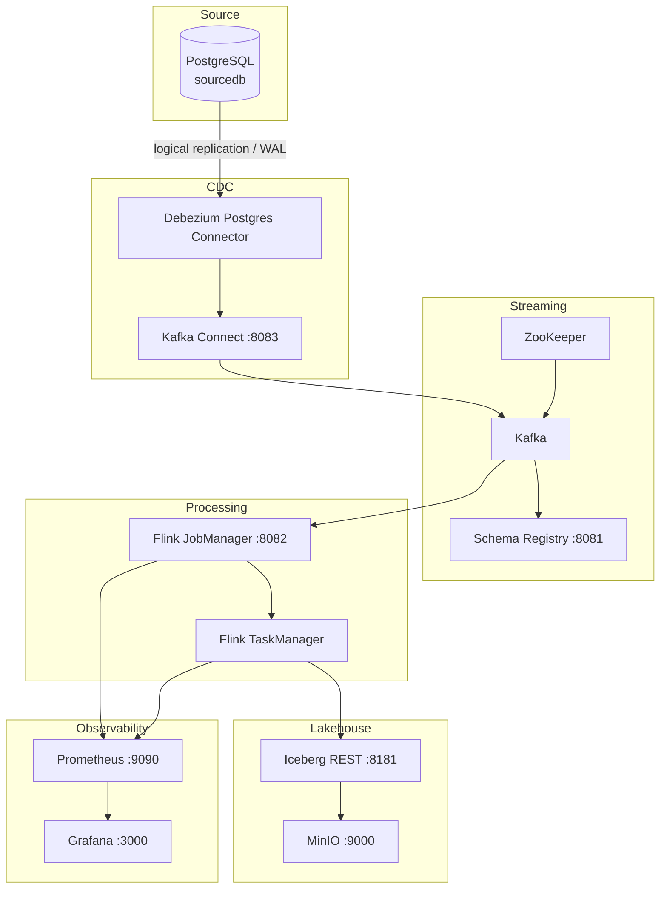

# Change Data Capture Pipeline

End-to-end **Change Data Capture (CDC)** pipeline that streams row-level changes from PostgreSQL into a lakehouse stack using **Debezium**, **Apache Kafka**, **Apache Flink**, and **Apache Iceberg**. Built as a portfolio data-engineering project demonstrating log-based replication, Avro schema management, exactly-once stream processing, dead-letter handling, and observability.

**Repository:** [github.com/isinghabhishek/change-data-capture-pipeline](https://github.com/isinghabhishek/change-data-capture-pipeline)

---

## Overview

| Layer | Technology | Role |
|-------|------------|------|
| Source | PostgreSQL 15 | Operational database with logical replication (`wal_level=logical`) |
| CDC | Debezium 2.5 (Kafka Connect) | Reads WAL via `pgoutput`, publishes Avro change events |
| Streaming | Kafka 7.6 + ZooKeeper | Durable, ordered change-event transport |
| Schema | Confluent Schema Registry | Avro schemas with backward compatibility |
| Processing | Apache Flink 1.18 | Consumes Kafka, upserts into Iceberg with checkpoints |
| Storage | MinIO + Iceberg REST catalog | S3-compatible object store and table metadata |
| Observability | Prometheus + Grafana | Metrics and dashboards for lag, checkpoints, DLQ |

Monitored source tables: `orders`, `customers`, `products`, plus a `cdc_heartbeat` table for pipeline latency measurement.

---

## Architecture



**Data flow (happy path):**

1. Application changes rows in PostgreSQL.
2. Debezium captures inserts, updates, and deletes and publishes to topics such as `db.public.orders`.
3. Flink consumes Avro events, applies upsert/delete semantics, and commits Iceberg tables transactionally.
4. A heartbeat row in `cdc_heartbeat` is updated every 60 seconds for end-to-end latency tracking.

**Failure path:** Unprocessable connector or Flink events are routed to `cdc.dead-letter-queue` with error metadata.

---

## Prerequisites

- **Docker Desktop** (or Docker Engine + Docker Compose v2)
- **8 GB+ RAM** recommended (Kafka, Flink, and PostgreSQL together are memory-heavy)
- **Java 11** and **Maven 3.8+** (to build and test the Flink job)
- **Python 3.10+** (utility scripts and tests)
- **bash** (for Makefile targets that call shell scripts, on Windows use Git Bash or WSL)

### Host ports

| Port | Service |
|------|---------|
| 5432 | PostgreSQL |
| 2181 | ZooKeeper |
| 9092 / 29092 | Kafka (internal / host) |
| 8081 | Schema Registry |
| 8083 | Kafka Connect (Debezium) |
| 8082 | Flink Web UI (mapped from 8081) |
| 9000 / 9001 | MinIO API / Console |
| 8181 | Iceberg REST catalog |
| 9090 | Prometheus |
| 3000 | Grafana |

---

## Quick start

### 1. Clone and configure

```bash
git clone https://github.com/isinghabhishek/change-data-capture-pipeline.git
cd change-data-capture-pipeline
cp .env.example .env
```

Edit `.env` and replace default passwords before any non-local use.

### 2. Start infrastructure

```bash
docker compose up -d
```

Wait until health checks pass (especially `kafka`, `schema-registry`, and `kafka-connect`). Check status:

```bash
docker compose ps
```

### 3. Initialize PostgreSQL

Run the idempotent setup script against the source database:

```bash
docker exec -i postgres psql -U postgres -d sourcedb < scripts/init-postgres.sql
```

This script:

- Creates the `cdc_user` replication role
- Creates sample tables (`orders`, `customers`, `products`, `cdc_heartbeat`)
- Creates publication `cdc_publication` and logical slot `debezium_slot`

> **Note:** `init-postgres.sql` seeds `cdc_user` with password `cdc_password`. Align this with `CDC_DB_PASSWORD` in your connector config and `.env`.

### 4. Create Kafka topics

From the host (with Python dependencies installed):

```bash
pip install -r requirements.txt
python scripts/create_topics.py --bootstrap-servers localhost:29092
```

Use `localhost:29092` from your machine; inside Docker networks use `kafka:9092`.

Preview topic definitions without creating them:

```bash
python scripts/create_topics.py --bootstrap-servers localhost:29092 --dry-run
```

### 5. Register the Debezium connector

```bash
curl -X POST http://localhost:8083/connectors \
  -H "Content-Type: application/json" \
  -d @connectors/debezium-postgres.json
```

Verify:

```bash
curl http://localhost:8083/connectors/debezium-postgres-connector/status
```

### 6. Verify change capture

Insert a row and consume from a CDC topic (example):

```bash
docker exec -it postgres psql -U postgres -d sourcedb -c \
  "INSERT INTO customers (name, email) VALUES ('Ada Lovelace', 'ada@example.com');"

docker exec -it kafka kafka-console-consumer \
  --bootstrap-server localhost:9092 \
  --topic db.public.customers \
  --from-beginning \
  --max-messages 1
```

### 7. Build and run the Flink job (optional)

```bash
cd flink-job
mvn package -DskipTests
```

Submit via the Flink REST API (JobManager exposed on host port **8082**):

```bash
# Upload JAR (example — adjust path after mvn package)
curl -X POST -H "Expect:" -F "jarfile=@target/cdc-pipeline-flink-job-1.0.0-SNAPSHOT.jar" \
  http://localhost:8082/jars/upload

# Run job (use jar id from upload response)
curl -X POST http://localhost:8082/jars/<JAR_ID>/run \
  -H "Content-Type: application/json" \
  -d '{"entryClass": "cdc.CdcPipelineJob"}'
```

Or use the Makefile shortcut after setting Flink host variables:

```bash
export FLINK_JOBMANAGER_HOST=localhost
export FLINK_JOBMANAGER_PORT=8082
make submit-job
```

Open the Flink UI at [http://localhost:8082](http://localhost:8082).

### 8. Monitoring

- **Grafana:** [http://localhost:3000](http://localhost:3000) — default user/password from `.env` (`GRAFANA_ADMIN_USER` / `GRAFANA_ADMIN_PASSWORD`)
- **Prometheus:** [http://localhost:9090](http://localhost:9090)
- **MinIO Console:** [http://localhost:9001](http://localhost:9001)

---

## Makefile commands

| Command | Description |
|---------|-------------|
| `make up` | `docker compose up -d` |
| `make down` | `docker compose down` |
| `make seed` | Runs `scripts/seed.sh` (creates sample data, topics, registers connector) |
| `make teardown` | Runs `scripts/teardown.sh` (removes volumes and replication slots) |
| `make test` | `mvn test` in `flink-job/` + `pytest tests/` |
| `make submit-job` | Package Flink JAR and submit `cdc.CdcPipelineJob` |

> `seed.sh` and `teardown.sh` are referenced by the Makefile but may not yet be present in the repo. Until they are added, use the manual steps in **Quick start** and **Teardown** below.

---

## Configuration

### Environment variables (`.env`)

| Variable | Description | Example |
|----------|-------------|---------|
| `POSTGRES_USER` | PostgreSQL superuser | `postgres` |
| `POSTGRES_PASSWORD` | PostgreSQL password | `changeme` |
| `POSTGRES_DB` | Source database name | `sourcedb` |
| `CDC_DB_USER` | Debezium replication user | `cdc_user` |
| `CDC_DB_PASSWORD` | Password for `cdc_user` | `changeme` |
| `MINIO_ROOT_USER` | MinIO access key | `minioadmin` |
| `MINIO_PASSWORD` | MinIO secret key | `changeme` |
| `KAFKA_BOOTSTRAP_SERVERS` | Kafka brokers (in-network) | `kafka:9092` |
| `SCHEMA_REGISTRY_URL` | Schema Registry URL | `http://schema-registry:8081` |
| `FLINK_JOBMANAGER_HOST` | Flink JobManager hostname | `jobmanager` |
| `FLINK_JOBMANAGER_PORT` | Flink REST port (internal 8081) | `8081` |
| `ICEBERG_REST_URL` | Iceberg REST catalog | `http://iceberg-rest:8181` |
| `ICEBERG_WAREHOUSE` | Warehouse path | `s3://warehouse/` |
| `GRAFANA_ADMIN_USER` | Grafana admin username | `admin` |
| `GRAFANA_ADMIN_PASSWORD` | Grafana admin password | `changeme` |

### Debezium connector highlights

File: `connectors/debezium-postgres.json`

- **Plugin:** `pgoutput`
- **Publication:** `cdc_publication`
- **Slot:** `debezium_slot`
- **Topic prefix:** `db` → topics like `db.public.orders`
- **Snapshot:** `initial` with minimal locking
- **Serializers:** Confluent Avro via Schema Registry
- **DLQ:** `cdc.dead-letter-queue`

---

## Project structure

```
change-data-capture-pipeline/
├── docker-compose.yml      # Full stack: PG, Kafka, Connect, Flink, MinIO, Iceberg, monitoring
├── .env.example            # Environment template
├── Makefile                # up / down / seed / test / submit-job
├── requirements.txt        # Python dependencies (Kafka admin, tests, WAL monitor)
├── connectors/
│   └── debezium-postgres.json
├── scripts/
│   ├── init-postgres.sql   # DB roles, tables, publication, replication slot
│   ├── create_topics.py    # Kafka topic provisioning
│   └── check_wal_lag.py    # Replication slot lag monitor
├── flink-job/              # Maven module: Kafka → Iceberg Flink application
│   ├── pom.xml
│   └── src/main/java/cdc/  # Models, operators, CdcPipelineJob
├── infra/
│   └── init-minio.sh
├── monitoring/             # Prometheus & Grafana provisioning
├── tests/                  # pytest + Hypothesis
└── .kiro/specs/cdc-pipeline/   # Design & requirements documentation
```

---

## Python utilities

### WAL lag monitor

Warns when replication slot lag exceeds 10 GB (configurable):

```bash
python scripts/check_wal_lag.py \
  --dsn "host=localhost port=5432 dbname=sourcedb user=cdc_user password=cdc_password" \
  --slot-name debezium_slot \
  --warn-threshold-gb 10
```

### Run tests

```bash
pip install -r requirements.txt
pytest tests/ -v
```

---

## Teardown

Stop containers:

```bash
docker compose down
```

Remove volumes and reset PostgreSQL replication state (destructive):

```bash
docker compose down -v
docker exec -i postgres psql -U postgres -d sourcedb -c \
  "SELECT pg_drop_replication_slot('debezium_slot');" 2>/dev/null || true
```

---

## Key design goals

- **Log-based CDC** from PostgreSQL WAL (no polling)
- **Initial snapshot** plus incremental streaming
- **Avro + Schema Registry** for typed, evolvable events
- **Exactly-once** Flink processing with RocksDB checkpoints stored in MinIO
- **Dead-letter queue** for poison messages and schema failures
- **Heartbeat-based latency** measurement (60 s interval)
- **Operational metrics** via Prometheus and Grafana

Detailed requirements and design notes live under `.kiro/specs/cdc-pipeline/`.

---

## Tech stack versions

| Component | Version |
|-----------|---------|
| PostgreSQL | 15 |
| Confluent Platform (Kafka, ZK, Schema Registry) | 7.6.0 |
| Debezium Connect | 2.5 |
| Apache Flink | 1.18 (Java 11) |
| Apache Iceberg (Flink runtime) | 1.5.2 |
| MinIO | latest |
| Iceberg REST (Tabulario) | latest |

---

## Troubleshooting

| Symptom | Things to check |
|---------|-----------------|
| Connect REST not ready | `docker logs kafka-connect` — wait for `service_healthy` |
| No Kafka messages | Connector status, replication slot active, publication includes table |
| Topic missing | Run `create_topics.py`; `KAFKA_AUTO_CREATE_TOPICS_ENABLE` is `false` |
| Schema errors | Schema Registry at `:8081`, Avro compatibility `backward` |
| High WAL disk use | `check_wal_lag.py`; consumer lag; slot `debezium_slot` |
| Flink job won't start | JAR built with `mvn package`; JobManager at `:8082`; MinIO buckets exist |

---

## Author

**Abhishek Singh** — [@isinghabhishek](https://github.com/isinghabhishek)

---

## License

No license file is included in this repository yet. Add a `LICENSE` file (for example, MIT or Apache-2.0) before publishing or reusing the code.
